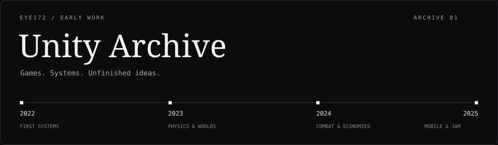
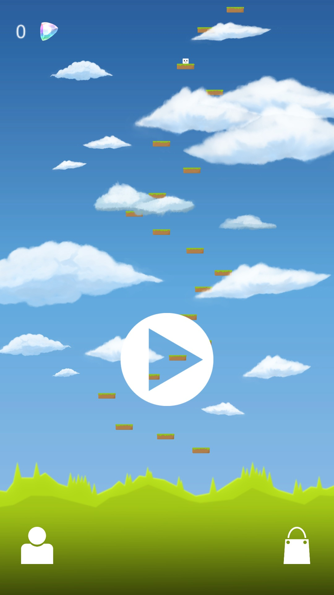

Games, unfinished ideas and small systems made while learning Unity, followed by a solo mobile-game project and a jam prototype. Preserved by **[Shakhnazar Akhmer / Eye172](https://github.com/Eye172)**.

**[Browse the projects](#the-collection)** · **[Chronology](docs/CHRONOLOGY.md)** · **[Source & credits](docs/SOURCE-NOTES.md)** · **[Restoration](docs/RESTORATION.md)**

## The collection

| Period | Project | What to explore |
|---|---|---|
| 2022–2023 · revisited in 2024 | **[First-person study](projects/2022-2023-first-person-study)** | Movement, projectiles and three enemy behaviours. |
| March–May 2023 | **[Physics playground](projects/2023-physics-playground)** | A Fall Guys-inspired parkour course for studying physics. |
| August 2023–April 2024 | **[City sandbox](projects/2023-2024-city-sandbox)** | A study in connecting character, vehicle and mission systems. |
| February 2024 | **[Cursed Prince](projects/2024-cursed-prince)** | A very early, Dark Souls-inspired 2D combat prototype. |
| June 2024–June 2025 | **[Rise](projects/2024-2025-rise)** | An unfinished mobile climbing prototype: a slime-cat escaping the darkness below. |
| July 2025 | **[POWER — Kenney Jam prototype](projects/2025-kenney-jam-power)** | One energy reserve for movement, light, combat and puzzles. |
| August 2025 | **[Directional movement study](projects/2025-directional-movement)** | Stepped movement while facing an opponent. |

## Recorded previews

| Mobile prototype | Two-day jam prototype |
|---|---|
|  |  |
| [Rise: menus, customization and a jump](projects/2024-2025-rise) | [POWER: factory, light and electricity puzzle](projects/2025-kenney-jam-power) |

Six project pages include screenshots. Four include short, silent clips recorded in Unity Editor preview; scripted mechanic tests are explicitly labeled. These are preserved prototypes with documented limitations.

## A learning timeline

**2022–2023 — foundations.** First-person movement, projectiles, enemy inheritance, collisions and physical obstacles.

**2023–2024 — connected systems.** A town prototype joins character controls, vehicles, UI, quests and a shop. Cursed Prince explores stamina-based combat.

**2024–2025 — independent game ideas.** Rise was intended for Google Play with advertising, but its level set remained unfinished. The Kenney Jam project explores a shared energy budget across movement, combat and puzzles; it was not submitted before the deadline. A later movement study isolates stepping and opponent-facing behaviour.

## About this archive

Seven documented projects share one repository. The historical project folders remain identifiable, and each page links directly to the relevant original C# files. The two nearly empty project seeds are recorded in [Chronology](docs/CHRONOLOGY.md), rather than presented as additional games.

This is a **historical source archive**. Gameplay scripts, scene descriptions, input settings and package manifests are preserved. The complete local originals also contain third-party art packs, which are handled separately in [Source notes](docs/SOURCE-NOTES.md). A public checkout alone is not represented as a complete playable build.

Dates describe surviving files and the author's account. The archive was assembled in **October 2026**; Git history is not backdated. See [verification status](docs/BUILD-STATUS.md) for what has actually been run and captured.

## License

**Viewing and personal study only.** Reuse, execution, modification and redistribution of the author's original material require prior written permission. This archive is not open source. See [LICENSE](LICENSE) for the scope, GitHub platform rights and other exceptions; third-party material retains its own terms. Permission requests: [shakh090909@gmail.com](mailto:shakh090909@gmail.com).
