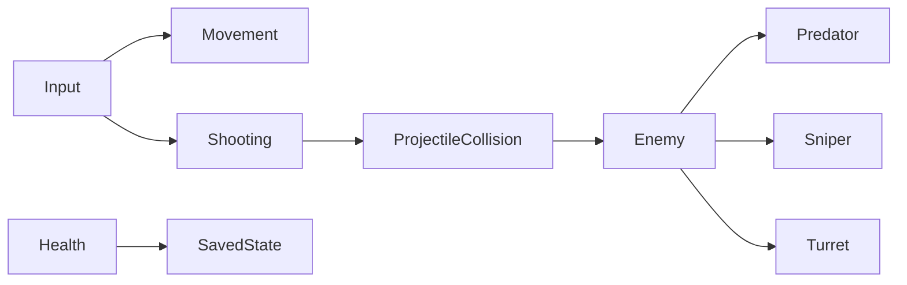

[← Unity archive](../../README.md) · [Chronology](../../docs/CHRONOLOGY.md) · [Source notes](../../docs/SOURCE-NOTES.md)

# First-person study

**2022–2023 · revisited in 2024** · Kodland Unity / Unity Pro learning archive

> Movement, projectiles and three enemy behaviours.

An early first-person prototype built while learning Unity. Movement, shooting, pickups and persistence are split into small components; a shared enemy base is extended into a pursuing enemy, a sniper and a stationary turret.

**Created by [Shakhnazar Akhmer / Eye172](https://github.com/Eye172).** Solo project; third-party art and packages are listed separately. Original folder: `TEST_1`. Unity **2021.3.14f1**, C#.

## Preview status

The project opened in Editor Play Mode and produced a Windows build. Its restored scene rendered too dark for a useful screenshot, so this entry presents the preserved source and scene structure without gameplay media.

## What is implemented

- First-person movement, mouse look, sprinting and jumping.
- Projectile spawning, collision handling, player health and pickups.
- Enemy inheritance: Enemy → Predator / SniperEnemy / Turret, with distinct movement and attack implementations.
- PlayerPrefs-based health and object-position persistence, plus a separate start-menu scene.

## Inside the project

| Source | Responsibility |
|---|---|
| [PlayerMove.cs](source/Assets/Scripts/PlayerMove.cs) | Movement, sprint, jumping and pickup triggers |
| [PlayerController.cs](source/Assets/Scripts/PlayerController.cs) | Health, shooting and restart state |
| [Enemy.cs](source/Assets/Scripts/Enemy.cs) | Shared enemy lifecycle |
| [Predator.cs](source/Assets/Scripts/Predator.cs) | Moving attacker |
| [SniperEnemy.cs](source/Assets/Scripts/SniperEnemy.cs) | Sniper attack behaviour |
| [Turret.cs](source/Assets/Scripts/Turret.cs) | Stationary firing behaviour |
| [save.cs](source/Assets/Scripts/save.cs) | Object-position and destruction-state persistence |

## Controls

| Input | Action |
|---|---|
| WASD / arrows | Move |
| Mouse | Look |
| Left click | Shoot |
| Left Shift | Sprint |
| Space | Jump |

## Saved scenes

| Scene | Serialized GameObjects¹ | Cameras¹ |
|---|---:|---:|
| [StartMenu](source/Assets/Scenes/StartMenu.unity) | 13 | 1 |
| [TESTGame](source/Assets/Scenes/TESTGame.unity) | 112 | 1 |

¹ Counts describe objects serialized directly in the scene, not expanded prefab contents or a performance metric. 10 C# files are preserved in the project's gameplay-script folder.

## Historical state and restoration

- The main body of dated scripts is from December 2022–March 2023. Enemy.cs has a later February 2024 modification.
- Restart clears this application's PlayerPrefs. Restoration builds use an isolated company identifier to avoid affecting historical saves.
- The saved build list starts in TESTGame; StartMenu is its second scene.

The source archive preserves the original bytes. Runtime verification and capture status are recorded in [BUILD-STATUS](../../docs/BUILD-STATUS.md). Imported art packs are not bundled blindly; see [dependencies](DEPENDENCIES.md) and [restoration instructions](../../docs/RESTORATION.md).

File-date evidence

These are preserved filesystem modification dates, not Git commit dates or exact development durations. Context was confirmed by the author on October 12, 2026.

| Gameplay script | Last modified |
|---|---|
| `PlayerLook.cs` | 2022-12-18 |
| `MenuNewGameButton.cs` | 2023-01-08 |
| `save.cs` | 2023-02-26 |
| `PlayerMove.cs` | 2023-02-26 |
| `Bullet.cs` | 2023-02-26 |
| `PlayerController.cs` | 2023-02-26 |
| `Turret.cs` | 2023-03-05 |
| `Predator.cs` | 2023-03-05 |
| `SniperEnemy.cs` | 2023-03-05 |
| `Enemy.cs` | 2024-02-21 |

