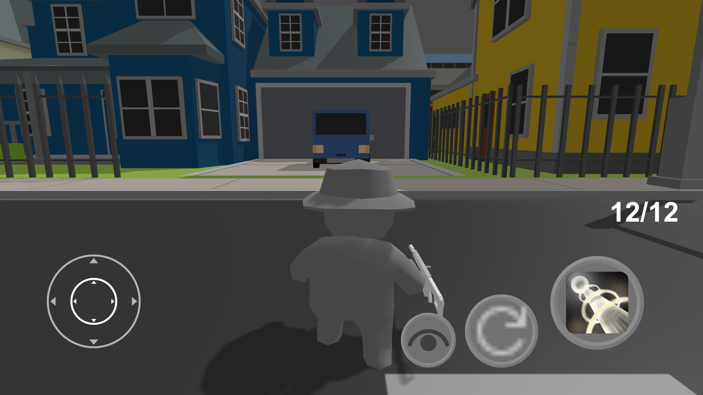
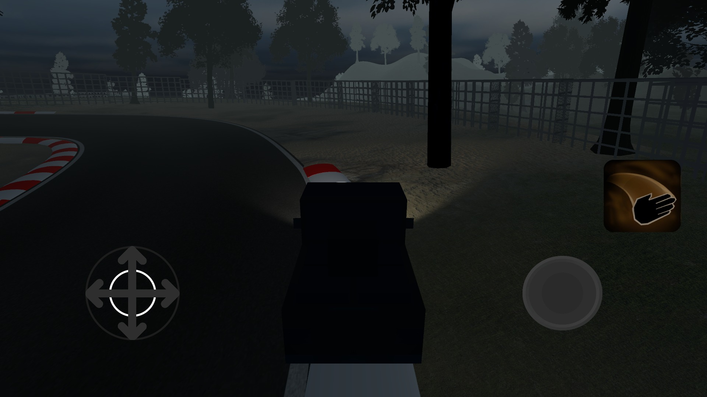
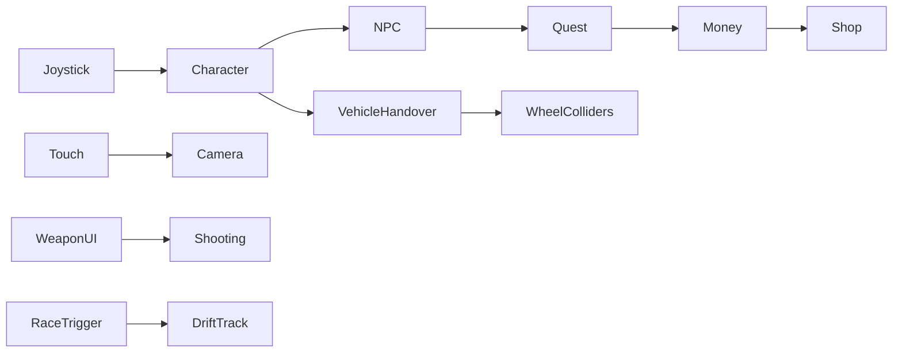

[← Unity archive](../../README.md) · [Chronology](../../docs/CHRONOLOGY.md) · [Source notes](../../docs/SOURCE-NOTES.md)

# City sandbox

**August 2023–April 2024** · Kodland Unity / Unity Pro learning archive

> A study in connecting character, vehicle and mission systems.

A larger learning project that brings several systems into one town scene: a character controller, weapons, NPC interactions, simple collection quests, a skin shop and driveable vehicles. A separate drift-track scene is part of the saved build configuration.

**Created by [Shakhnazar Akhmer / Eye172](https://github.com/Eye172).** Solo project; third-party art and packages are listed separately. Original folder: `Project_2`. Unity **2021.3.14f1**, C#.

## In Unity Device Simulator

Landscape Google Pixel 2 preview, 1920 × 1080. The short clip shows the original on-screen joystick moving the character toward a parked vehicle. It does not claim that the vehicle-entry flow or quests were completed.

[Watch the movement sample](media/demo.mp4)

Separate driving-track scene

The preserved track scene has visibly dark lighting; this screenshot is shown as an unfinished study, without recolouring or relighting it.

## What is implemented

- Touch-oriented character movement, camera look and weapon UI.
- Raycast shooting, reload state, health and money UI.
- Entering / leaving a car with camera and UI handover.
- WheelCollider-based steering, motor torque and braking.
- NPC interactions, collection quests, rewards and a skin shop.
- Navigation, ragdoll and inverse-kinematics experiments; transition to a race scene.

## Inside the project

| Source | Responsibility |
|---|---|
| [PlayerController.cs](source/Assets/Scripts/PlayerController.cs) | Shooting, health, money and reloading |
| [PlayerMove.cs](source/Assets/Scripts/PlayerMove.cs) | Joystick-driven Rigidbody movement |
| [CarController.cs](source/Assets/Scripts/CarController.cs) | WheelCollider axles, torque and braking |
| [go_to_car.cs](source/Assets/Scripts/go_to_car.cs) | Character-to-vehicle camera and UI handover |
| [quest.cs](source/Assets/Scripts/quest.cs) | Collection objective and reward |
| [shop.cs](source/Assets/Scripts/shop.cs) | Skin selection and purchase state |
| [NavigationAI.cs](source/Assets/Scripts/NavigationAI.cs) | Navigation behaviour |
| [go_to_race_scr.cs](source/Assets/Scripts/go_to_race_scr.cs) | Race-scene transition |

## Controls

| Input | Action |
|---|---|
| On-screen joystick | Character / vehicle movement |
| Touch drag | Look |
| On-screen buttons | Fire, reload, jump, enter vehicle and interact |
| Q | Quit |

## Saved scenes

| Scene | Serialized GameObjects¹ | Cameras¹ |
|---|---:|---:|
| [Menu_1](source/Assets/Scenes/Menu_1.unity) | 19 | 1 |
| [SampleScene](source/Assets/Scenes/SampleScene.unity) | 2 | 1 |
| [SimpleTown_DemoScene](source/Assets/Scenes/SimpleTown_DemoScene.unity) | 115 | 2 |

¹ Counts describe objects serialized directly in the scene, not expanded prefab contents or a performance metric. 27 C# files are preserved in the project's gameplay-script folder.

## Historical state and restoration

- The dated gameplay scripts run from August 16, 2023 to April 14, 2024. An older empty SampleScene and imported demo dates do not establish the project's start date.
- The original scene list starts with the town, then Menu_1, then Drift Track. The menu StartGame method also loads index 1; that transition needs runtime checking.
- The controller expects the third-party Joystick component. The imported asset packs are preserved locally and listed separately rather than silently republished.

The source archive preserves the original bytes. Runtime verification and capture status are recorded in [BUILD-STATUS](../../docs/BUILD-STATUS.md). Imported art packs are not bundled blindly; see [dependencies](DEPENDENCIES.md) and [restoration instructions](../../docs/RESTORATION.md).

File-date evidence

These are preserved filesystem modification dates, not Git commit dates or exact development durations. Context was confirmed by the author on October 12, 2026.

| Gameplay script | Last modified |
|---|---|
| `ExitGame.cs` | 2023-08-16 |
| `menu.cs` | 2023-09-06 |
| `Volume.cs` | 2023-09-06 |
| `OpticalSight.cs` | 2023-09-20 |
| `PlayerMove.cs` | 2023-09-20 |
| `IKControl.cs` | 2023-10-04 |
| `Step.cs` | 2023-10-04 |
| `barrel_scr.cs` | 2023-10-04 |
| `Bullet.cs` | 2023-10-04 |
| `Ragdoll.cs` | 2023-10-04 |
| `IKControl2.cs` | 2023-10-04 |
| `NavMen.cs` | 2023-10-11 |
| `dropBox.cs` | 2023-10-18 |
| `Bird.cs` | 2023-10-18 |
| `NavigationAI.cs` | 2023-10-25 |
| `EnemyAI.cs` | 2023-10-25 |
| `Spawner.cs` | 2023-11-01 |
| `spisok_zadaniy.cs` | 2023-11-15 |
| `npc_scr.cs` | 2023-11-22 |
| `PlayerController.cs` | 2023-11-22 |
| `quest.cs` | 2023-11-22 |
| `shop.cs` | 2023-11-29 |
| `go_to_car.cs` | 2023-12-13 |
| `go_to_race_scr.cs` | 2023-12-20 |
| `race_scr.cs` | 2023-12-20 |
| `PlayerLook.cs` | 2024-04-06 |
| `CarController.cs` | 2024-04-14 |

