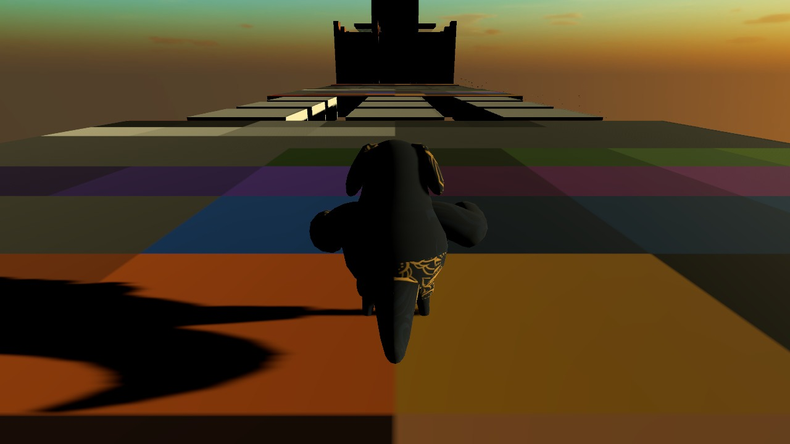
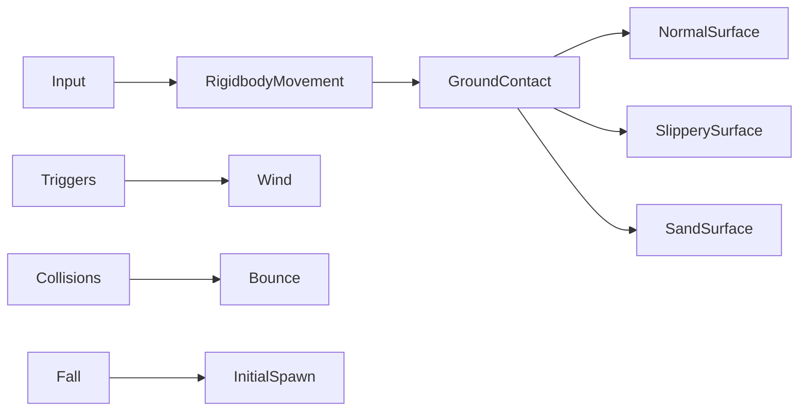

[← Unity archive](../../README.md) · [Chronology](../../docs/CHRONOLOGY.md) · [Source notes](../../docs/SOURCE-NOTES.md)

# Physics playground

**March–May 2023** · Kodland Unity / Unity Pro learning archive

> A Fall Guys-inspired parkour course for studying physics.

A solo learning prototype inspired by Fall Guys: move and jump through a parkour course of slippery surfaces, wind, bouncing objects, pendulums and unstable platforms. Its purpose was to study how Unity collisions, Rigidbody forces and environmental mechanisms affect a controllable character.

**Created by [Shakhnazar Akhmer / Eye172](https://github.com/Eye172).** Solo project; third-party art and packages are listed separately. Original folder: `FIZIKA_1`. Unity **2021.3.14f1**, C#.

## Preview

The restored starting platform, captured in Unity Editor Play Mode. The course retains rough, dark lighting; the checkpoint and fall-recovery correction passed six runtime checks.

## What is implemented

- Rigidbody movement with jumping and different behaviour on slippery and sandy surfaces.
- Wind volumes and collision-driven bounce / trampoline interactions.
- Pendulum and rotating obstacle scripts.
- Randomly released door and platform rigidbodies.
- Fall recovery; the historical checkpoint is temporarily disabled in the October 2026 restoration.

## Inside the project

| Source | Responsibility |
|---|---|
| [PlayerMoveFall.cs](source/Assets/Scripts/PlayerMoveFall.cs) | Movement and surface-specific physics |
| [WindForce.cs](source/Assets/Scripts/WindForce.cs) | Force applied inside a trigger volume |
| [Bounce.cs](source/Assets/Scripts/Bounce.cs) | Collision impulse |
| [Pendulum.cs](source/Assets/Scripts/Pendulum.cs) | Oscillating obstacle |
| [BrokenDoors.cs](source/Assets/Scripts/BrokenDoors.cs) | Randomly unlocked physics door |
| [FallPlatforms.cs](source/Assets/Scripts/FallPlatforms.cs) | Randomly released platform |
| [AntiAbyss.cs](source/Assets/Scripts/AntiAbyss.cs) | Fall recovery and checkpoint |

## Controls

| Input | Action |
|---|---|
| WASD / arrows | Move |
| Mouse | Look |
| Space | Jump |

## Saved scenes

| Scene | Serialized GameObjects¹ | Cameras¹ |
|---|---:|---:|
| [SampleScene](source/Assets/Scenes/SampleScene.unity) | 133 | 1 |

¹ Counts describe objects serialized directly in the scene, not expanded prefab contents or a performance metric. 11 C# files are preserved in the project's gameplay-script folder.

## Historical state and restoration

- Dated gameplay files span March 19–May 21, 2023.
- The original EditorBuildSettings has no enabled scene. Restoration explicitly selects Assets/Scenes/SampleScene.unity.
- The prototype uses legacy input and the built-in physics systems.
- At the author’s request, the October 2026 restoration disables the broken checkpoint and places the player on the first platform. Falling returns to that start with velocity cleared. The 2023 snapshot remains byte-preserved under source; the two revised files are separately recorded under restoration-2026.

The source archive preserves the original bytes. Runtime verification and capture status are recorded in [BUILD-STATUS](../../docs/BUILD-STATUS.md). Imported art packs are not bundled blindly; see [dependencies](DEPENDENCIES.md) and [restoration instructions](../../docs/RESTORATION.md).

File-date evidence

These are preserved filesystem modification dates, not Git commit dates or exact development durations. Context was confirmed by the author on October 12, 2026.

| Gameplay script | Last modified |
|---|---|
| `PlayerLookFallGuys.cs` | 2023-03-19 |
| `WindForce.cs` | 2023-04-09 |
| `BrokenDoors.cs` | 2023-04-16 |
| `FallPlatforms.cs` | 2023-04-16 |
| `Batoot.cs` | 2023-04-16 |
| `AntiAbyss.cs` | 2023-04-23 |
| `Bounce.cs` | 2023-05-07 |
| `Bulava1.cs` | 2023-05-21 |
| `Shar.cs` | 2023-05-21 |
| `Pendulum.cs` | 2023-05-21 |
| `PlayerMoveFall.cs` | 2023-05-21 |

