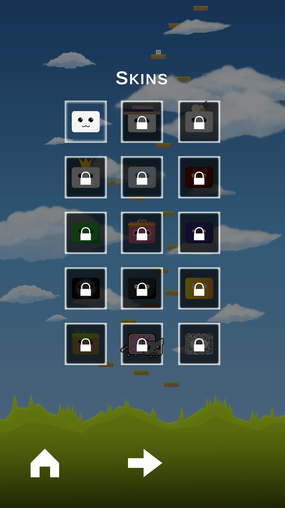
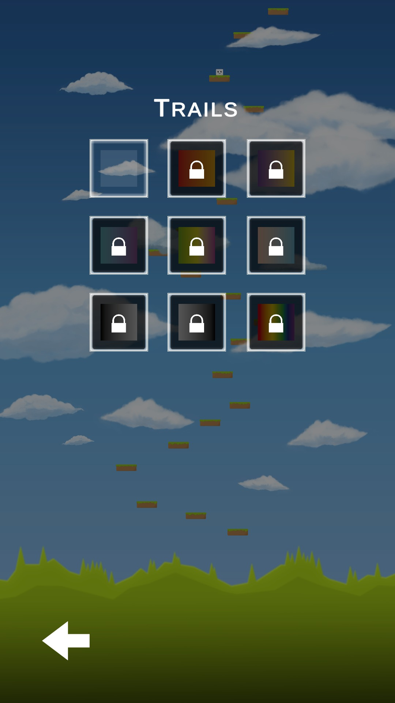
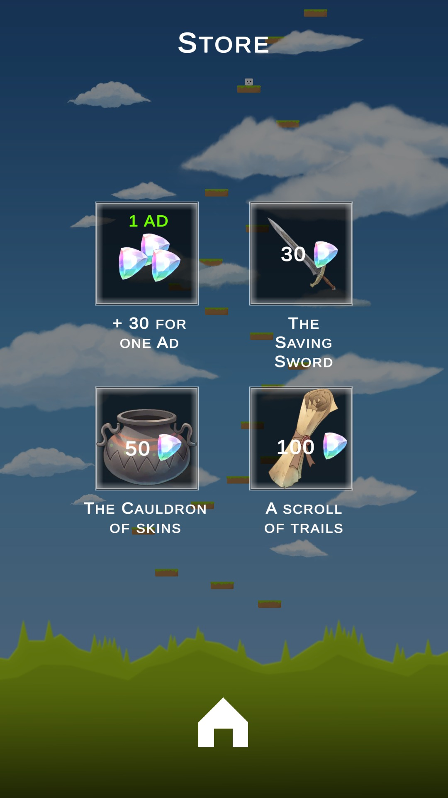
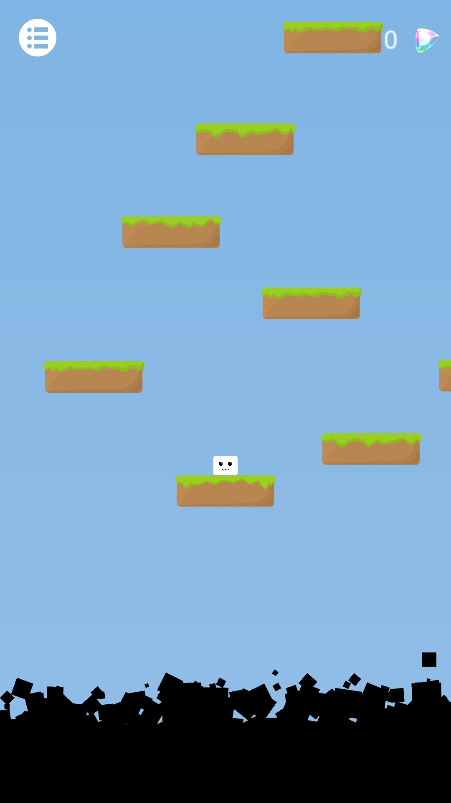
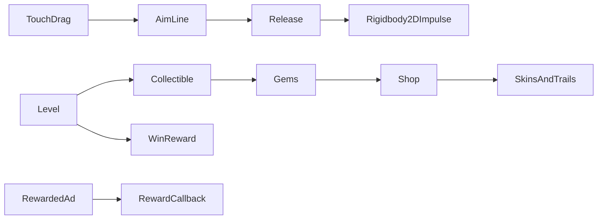

[← Unity archive](../../README.md) · [Chronology](../../docs/CHRONOLOGY.md) · [Source notes](../../docs/SOURCE-NOTES.md)

# Rise

**June 2024–June 2025** · Solo mobile-game project · unreleased

> An unfinished mobile climbing prototype: a slime-cat escaping the darkness below.

Rise began as a solo mobile-game idea intended for Google Play, with advertising as its planned business model. A cube-shaped slime-cat climbs through floating terrain while hostile black darkness rises from below. The saved MVP contains touch-drag launching, two level scenes, collectibles, temporary modifiers and customization menus. The author found the controls too difficult; development stopped before the levels and broader feature set were completed. The two saved scenes are prototype material, not a finished campaign.

**Created by [Shakhnazar Akhmer / Eye172](https://github.com/Eye172).** Solo project; third-party art and packages are listed separately. Original folder: `Rise_Version_N1`. Unity **2021.3.14f1**, C#.

## In Unity Play Mode

Captured from the original scenes in Unity 2021.3.14f1, through **Device Simulator (Google Pixel 2), 1080 × 1920 portrait**. The short clip shows a touch-drag launch and landing on the next platform, using the original controller with Device Simulator touch input. It is a mechanic sample, not a complete level playthrough.

[Watch the launch and landing](media/demo.mp4)

| Home | Character customization |
|---|---|
|  |  |

| Trails | Shop |
|---|---|
|  |  |

| First prototype level | |
|---|---|
|  | |

## What is implemented

- Touch-and-drag aiming through a LineRenderer, then a Rigidbody2D launch on release.
- A maximum drag distance and velocity threshold that control when and how a launch can start.
- Collectible gems, a win reward, falling hazards, moving and breaking objects.
- Temporary gameplay modifiers and items, including potion, sword and protection scripts.
- Skin / trail selection, purchase state and saved progress through PlayerPrefs.
- Unity Ads initialization and rewarded-ad callbacks; monetization integration exists in source, not a claim of live earnings.

## Original vision

The intended journey led **from darkness toward light**. The slime-cat and its friends lived on a floating island until darkness rose from below. The protagonist would flee upward through worlds with distinct visual styles, eventually reaching a heavenly, Olympus-like final realm. After gaining a golden weapon and a form of enlightenment, the character would descend again to confront the darkness and rescue its friends.

The combat concept extended the launch mechanic: jump, strike an enemy, rebound from the hit and chain another airborne attack. A grapple or slime-like tether would attach the character to floating ground blocks. Other planned systems included time stop, parrying, enemy types, friendly NPCs, buffs and temporary chest loot: shields absorbing one or two hits, and armour with a chance to prevent damage.

The author described the intended feel through Moon Frog's upward mobile jumping, Ninja Tobu-like attachment to surfaces, a Starlit Adventures-like journey, and a reversal of the light-versus-dark imagery of Hollow Knight's Radiance encounter. These are creative references recalled by the author, not claims of equivalent scope or fidelity.

**This is the design vision, not the shipped feature list.** The surviving source has early sword/protection/potion components, but does not establish a completed grapple, parry system, NPC campaign, multi-world progression or final boss. The narrative and combat chain remained ambitions beyond the saved MVP.

## Inside the project

| Source | Responsibility |
|---|---|
| [Player_Controller1.cs](source/Assets/Scripts_/Player_Controller1.cs) | Touch aiming and launch impulse |
| [Menu_Script.cs](source/Assets/Scripts_/Menu_Script.cs) | Level and menu navigation |
| [Game_Menu_Script.cs](source/Assets/Scripts_/Game_Menu_Script.cs) | Pause, restart and level transitions |
| [StoreMenu_Script.cs](source/Assets/Scripts_/StoreMenu_Script.cs) | Shop logic |
| [LockerMenuScript.cs](source/Assets/Scripts_/LockerMenuScript.cs) | Skin and trail selection |
| [Gem_Script_.cs](source/Assets/Scripts_/Gem_Script_.cs) | Collectible currency |
| [Win_Script.cs](source/Assets/Scripts_/Win_Script.cs) | Win state and reward |
| [AdsInitializer.cs](source/Assets/Scripts_/AdsInitializer.cs) | Unity Ads initialization |
| [RewardedAdsButton.cs](source/Assets/Scripts_/RewardedAdsButton.cs) | Rewarded-ad lifecycle |

## Controls

| Input | Action |
|---|---|
| Touch, drag, release | Aim and launch the character |
| On-screen menus | Level selection, shop, skins and trails |

## Saved scenes

| Scene | Serialized GameObjects¹ | Cameras¹ |
|---|---:|---:|
| [Level_N1](source/Assets/My_Scenes/Level_N1.unity) | 21 | 1 |
| [Level_N2](source/Assets/My_Scenes/Level_N2.unity) | 22 | 1 |
| [MainMenu](source/Assets/My_Scenes/MainMenu.unity) | 274 | 1 |

¹ Counts describe objects serialized directly in the scene, not expanded prefab contents or a performance metric. 25 C# files are preserved in the project's gameplay-script folder.

## Historical state and restoration

- Most initial scripts are dated June–September 2024; scenes and menu work were revised June 20–25, 2025.
- The menu exposes more level buttons than the two saved level scenes. The intended level set was not completed.
- The original launch controller reads touch input only. Desktop footage requires either touch-capable input or a clearly documented preview-only mouse adapter.
- Public demos must use test-mode ads or disable ad requests; they must not generate production ad impressions.
- Author clarification, October 2026: the MVP survived, but the controls were too complex and the intended levels, worlds and expanded mechanics were never finished.

The source archive preserves the original bytes. Runtime verification and capture status are recorded in [BUILD-STATUS](../../docs/BUILD-STATUS.md). Imported art packs are not bundled blindly; see [dependencies](DEPENDENCIES.md) and [restoration instructions](../../docs/RESTORATION.md).

File-date evidence

These are preserved filesystem modification dates, not Git commit dates or exact development durations. Context was confirmed by the author on October 12, 2026.

| Gameplay script | Last modified |
|---|---|
| `Camera_Move.cs` | 2024-06-19 |
| `Anti_Abyss.cs` | 2024-06-19 |
| `Audio_Controller.cs` | 2024-06-21 |
| `Moving_Object.cs` | 2024-07-13 |
| `Gems_Text_.cs` | 2024-08-04 |
| `Gem_Script_.cs` | 2024-08-04 |
| `Breaking_Object.cs` | 2024-08-26 |
| `Fall_Zone_Move.cs` | 2024-08-26 |
| `Player_Controller1.cs` | 2024-08-26 |
| `Grass1_Script.cs` | 2024-08-26 |
| `Grass3_Script.cs` | 2024-08-26 |
| `Bread_Script.cs` | 2024-08-26 |
| `Win_Script.cs` | 2024-08-27 |
| `Grass2_Script.cs` | 2024-08-27 |
| `Potion_Script.cs` | 2024-08-27 |
| `LockerMenuScript.cs` | 2024-09-01 |
| `Variables_.cs` | 2025-06-20 |
| `StoreMenu_Script.cs` | 2025-06-20 |
| `Sword_Script.cs` | 2025-06-20 |
| `Fall_Script.cs` | 2025-06-20 |
| `Game_Menu_Script.cs` | 2025-06-20 |
| `Menu_Script.cs` | 2025-06-20 |
| `Protector_Script.cs` | 2025-06-20 |
| `AdsInitializer.cs` | 2025-06-24 |
| `RewardedAdsButton.cs` | 2025-06-24 |

