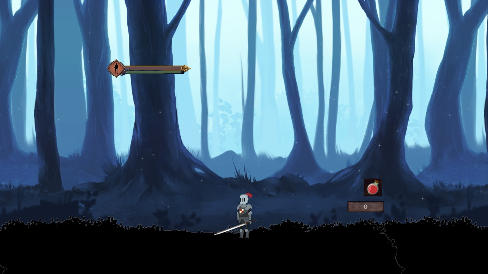
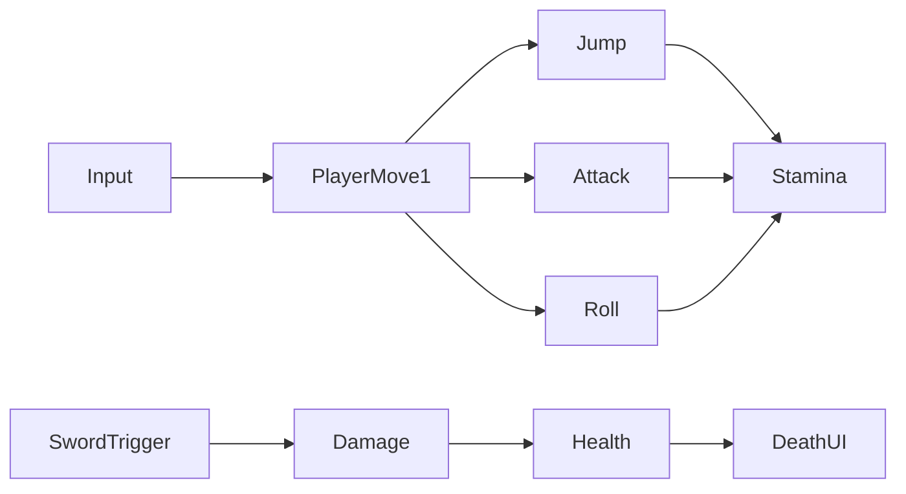

[← Unity archive](../../README.md) · [Chronology](../../docs/CHRONOLOGY.md) · [Source notes](../../docs/SOURCE-NOTES.md)

# Cursed Prince

**February 2024** · Kodland Unity / Unity Pro learning archive

> A very early, Dark Souls-inspired 2D combat prototype.

A rough 2D prototype inspired by Dark Souls, built around the rhythm of attacking, dodging and recovering stamina. Jumping, attacking and rolling spend a shared stamina reserve; healing uses limited potions. Sword-trigger components connect attacks to health and death behaviour. This is an early experiment in combat feel, not a finished soulslike or a complete adventure.

**Created by [Shakhnazar Akhmer / Eye172](https://github.com/Eye172).** Solo project; third-party art and packages are listed separately. Original folder: `Cursed_Prince_Version_N1`. Unity **2021.3.14f1**, C#.

## Preview

The forest scene and player HUD in Unity Editor Play Mode. This is a very early prototype; the source implements combat systems, but a complete combat sequence was not verified during restoration.

## What is implemented

- Horizontal movement, jumping and animated melee attacks.
- Stamina spending for jump, attack and roll, followed by delayed regeneration.
- A roll state that suppresses incoming health changes while active.
- Limited healing potions, health / stamina bars, a souls counter and death UI.
- A substantial DarkForestLocation scene plus a menu and earlier study scenes.

## Inside the project

| Source | Responsibility |
|---|---|
| [PlayerMove1.cs](source/Assets/Scripts/PlayerMove1.cs) | Movement, stamina, roll, potions and death UI |
| [Enemy1.cs](source/Assets/Scripts/Enemy1.cs) | Enemy damage, attack and death |
| [PlayerSword.cs](source/Assets/Scripts/PlayerSword.cs) | Player sword trigger |
| [EnemySword.cs](source/Assets/Scripts/EnemySword.cs) | Enemy sword trigger |
| [Music.cs](source/Assets/Scripts/Music.cs) | Audio trigger |
| [Menu.cs](source/Assets/Scripts/Menu.cs) | Menu transitions |

## Controls

| Input | Action |
|---|---|
| A / D or arrows | Move |
| W | Jump |
| Left click | Attack |
| Space | Roll |
| R | Drink a healing potion |

## Saved scenes

| Scene | Serialized GameObjects¹ | Cameras¹ |
|---|---:|---:|
| [Art](source/Assets/Scenes/Art.unity) | 51 | 1 |
| [DarkForestLocation](source/Assets/Scenes/DarkForestLocation.unity) | 493 | 1 |
| [Game](source/Assets/Scenes/Game.unity) | 91 | 1 |
| [Menu](source/Assets/Scenes/Menu.unity) | 11 | 1 |
| [SampleScene](source/Assets/Scenes/SampleScene.unity) | 59 | 1 |

¹ Counts describe objects serialized directly in the scene, not expanded prefab contents or a performance metric. 8 C# files are preserved in the project's gameplay-script folder.

## Historical state and restoration

- The gameplay scripts are dated February 12–28, 2024. Two older scenes dated July 2022 are retained as artifacts, not used to claim a 2022 start.
- The similarly named The_Cursed_Prince_V1 folder contains an empty scene and no gameplay scripts; it is not a second finished game.
- The original build starts in SampleScene; the forest and menu are subsequent scenes. The menu settings method is a placeholder.

The source archive preserves the original bytes. Runtime verification and capture status are recorded in [BUILD-STATUS](../../docs/BUILD-STATUS.md). Imported art packs are not bundled blindly; see [dependencies](DEPENDENCIES.md) and [restoration instructions](../../docs/RESTORATION.md).

File-date evidence

These are preserved filesystem modification dates, not Git commit dates or exact development durations. Context was confirmed by the author on October 12, 2026.

| Gameplay script | Last modified |
|---|---|
| `Moveset.cs` | 2024-02-12 |
| `EnemySword.cs` | 2024-02-21 |
| `CameraMove2.cs` | 2024-02-28 |
| `Enemy1.cs` | 2024-02-28 |
| `PlayerSword.cs` | 2024-02-28 |
| `Menu.cs` | 2024-02-28 |
| `PlayerMove1.cs` | 2024-02-28 |
| `Music.cs` | 2024-02-28 |

