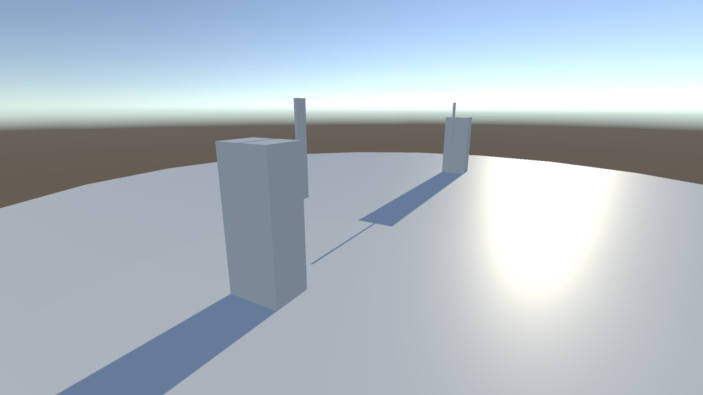
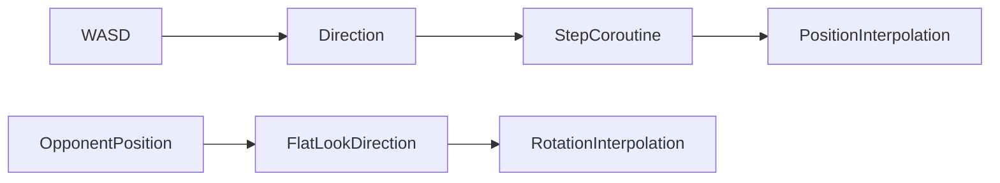

[← Unity archive](../../README.md) · [Chronology](../../docs/CHRONOLOGY.md) · [Source notes](../../docs/SOURCE-NOTES.md)

# Directional movement study

**August 2025** · Unity learning prototype

> Stepped movement while facing an opponent.

A small movement prototype stored as SwordFightGame_N1. The saved implementation moves a character in short interpolated steps and continuously rotates it toward an assigned opponent. Its scope is movement and facing; a complete sword-combat system is not present in the three saved scripts.

**Created by [Shakhnazar Akhmer / Eye172](https://github.com/Eye172).** Solo project; third-party art and packages are listed separately. Original folder: `SwordFightGame_N1`. Unity **2021.3.14f1**, C#.

## Preview

The movement study in Unity Device Simulator. The four-second clip is a scripted test calling the original movement coroutine: stepping and opponent-facing, without a combat system.

[Watch the movement test · 4 seconds](media/demo.mp4)

## What is implemented

- WASD input mapped to world-space directions.
- Coroutine-based interpolation over a configurable step distance and duration.
- Smooth facing toward a target, constrained to the horizontal plane.
- A compact scene suitable for inspecting the controller in isolation.

## Inside the project

| Source | Responsibility |
|---|---|
| [PlayerController.cs](source/Assets/Scripts/PlayerController.cs) | Input direction and interpolated step |
| [PlayerRotate.cs](source/Assets/Scripts/PlayerRotate.cs) | Opponent-facing rotation |
| [CameraMove.cs](source/Assets/Scripts/CameraMove.cs) | Camera scaffold |

## Controls

| Input | Action |
|---|---|
| W / S | Step along the positive / negative X axis |
| A / D | Step along the positive / negative Z axis |

## Saved scenes

| Scene | Serialized GameObjects¹ | Cameras¹ |
|---|---:|---:|
| [SampleScene](source/Assets/Scenes/SampleScene.unity) | 10 | 1 |

¹ Counts describe objects serialized directly in the scene, not expanded prefab contents or a performance metric. 3 C# files are preserved in the project's gameplay-script folder.

## Historical state and restoration

- All three scripts and the scene carry August 20, 2025 modification dates.
- The original build scene list is empty; restoration explicitly selects SampleScene.
- No attack, damage or victory system is claimed from the folder name alone.

The source archive preserves the original bytes. Runtime verification and capture status are recorded in [BUILD-STATUS](../../docs/BUILD-STATUS.md). Imported art packs are not bundled blindly; see [dependencies](DEPENDENCIES.md) and [restoration instructions](../../docs/RESTORATION.md).

File-date evidence

These are preserved filesystem modification dates, not Git commit dates or exact development durations. Context was confirmed by the author on October 12, 2026.

| Gameplay script | Last modified |
|---|---|
| `CameraMove.cs` | 2025-08-20 |
| `PlayerRotate.cs` | 2025-08-20 |
| `PlayerController.cs` | 2025-08-20 |

