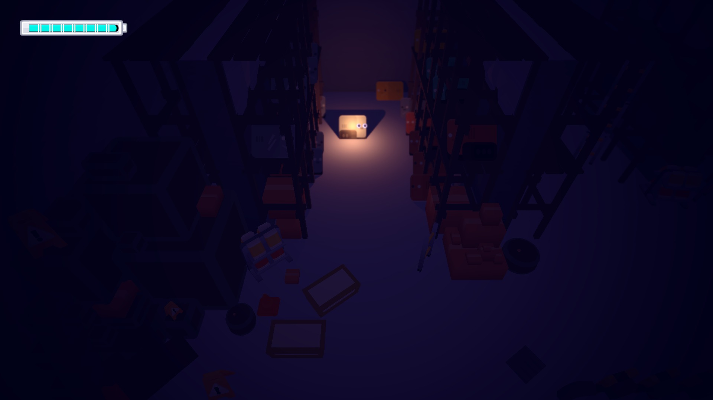
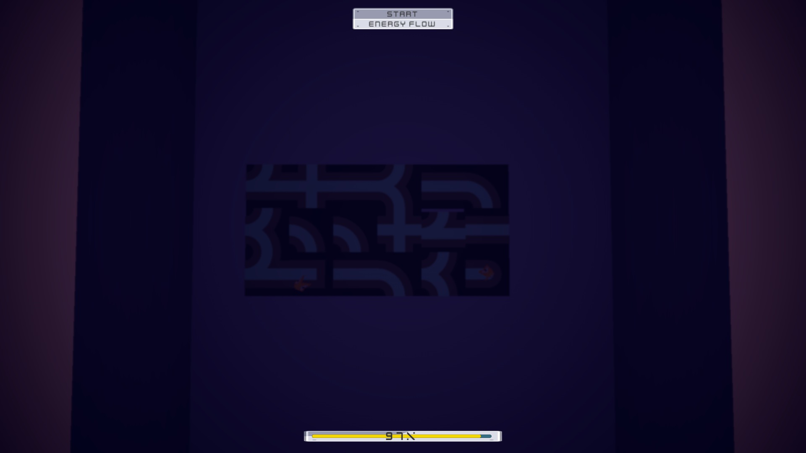
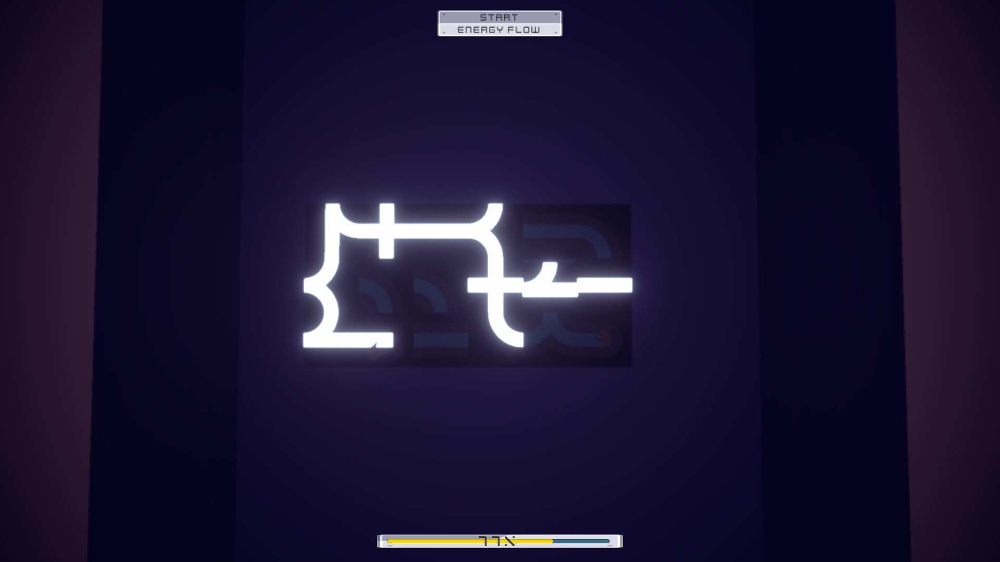
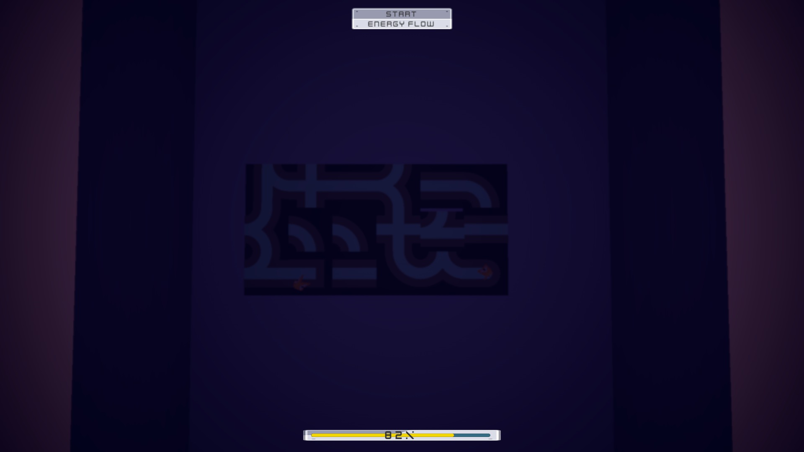
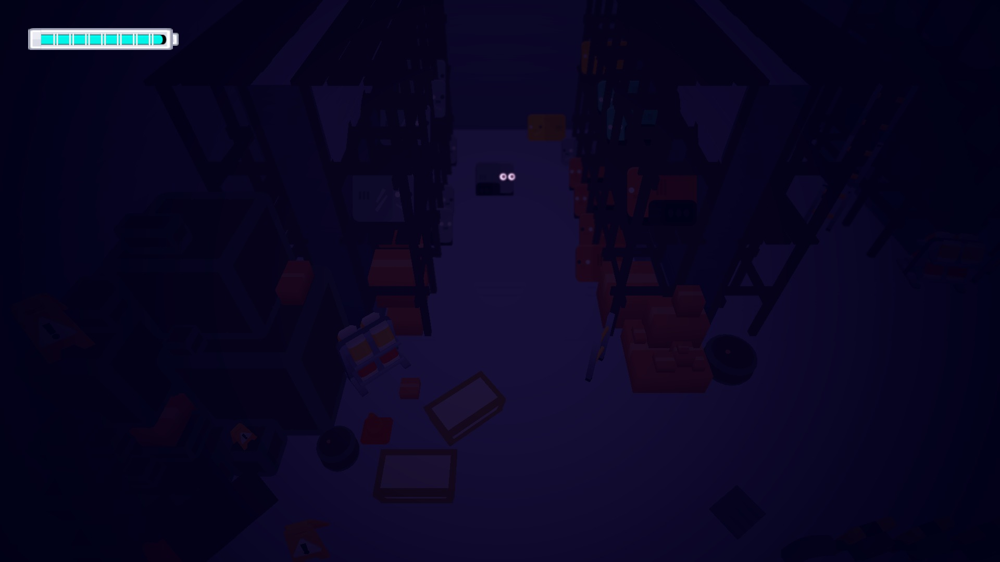
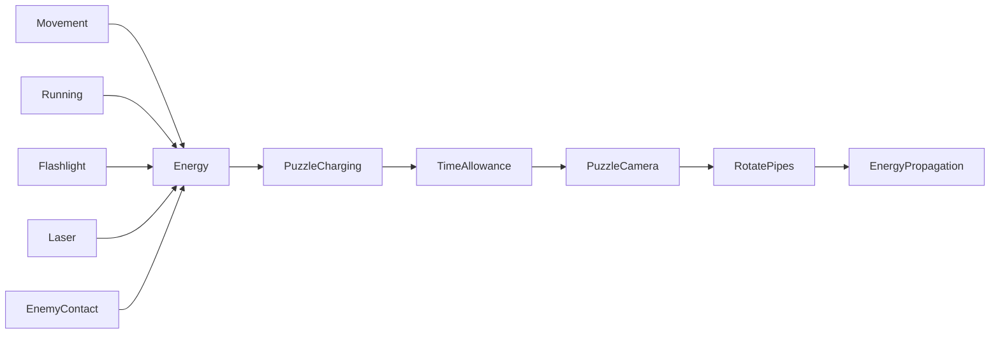

[← Unity archive](../../README.md) · [Chronology](../../docs/CHRONOLOGY.md) · [Source notes](../../docs/SOURCE-NOTES.md)

# POWER — Kenney Jam prototype

**July 2025** · Built for Kenney Jam 2025 · not submitted

> One energy reserve for movement, light, combat and puzzles.

A solo prototype made in two days for Kenney Jam 2025 and its POWER theme. A robot wakes in a mysterious factory among shelves of broken robots. It alone still has electricity: exploring the dark space, using the flashlight, fighting hostile creatures and powering pipe puzzles draw on a shared energy reserve. The mood and puzzle loop were the centre of the idea. A power outage and connectivity problems during the last-minute upload prevented submission; this is an unsubmitted jam prototype, not an official entry or ranked result. The historical folder is SomeGame; POWER identifies the event theme rather than a released game title.

**Created by [Shakhnazar Akhmer / Eye172](https://github.com/Eye172).** Solo project; third-party art and packages are listed separately. Original folder: `SomeGame`. Unity **2021.3.14f1**, C#.

## Factory and power puzzle

The robot's own flashlight is enabled with **F**. The original dark factory atmosphere and materials are preserved.

| Board before rotation | Power flowing through the assembled route |
|---|---|
|  |  |

[Watch the 14-second puzzle solution](media/puzzle-demo.mp4)

Click pipe tiles to rotate them by **90°**, build an unbroken route from the **energy source to the target**, then press **Start Energy Flow** before the energy/time bar at the bottom expires. In this take, four rotations connect the route; power reaches the target and the camera returns to the robot with **76%** of the time allowance remaining.

Recorded in Unity Editor Device Simulator at 1920 × 1080. This is a **scripted solution demonstration**: the capture harness dispatches the tiles' original click handlers and invokes the original flow button. The real timer, pipe rotations, energy propagation and target-activation check run unchanged; no victory flag is injected. It demonstrates this puzzle, rather than a continuous factory/combat walkthrough. The historical gameplay scripts are unchanged.

Factory with the flashlight off

## What is implemented

- CharacterController movement with energy-dependent running and shooting.
- A toggleable flashlight and persistent energy state.
- Charging a puzzle by transferring energy into a time allowance.
- A separate puzzle camera and canvas, rotating pipe tiles and propagated energy connections.
- Enemy idle / patrol / chase states, laser damage and contact energy drain.
- A saved URP level with a second camera for puzzle interaction.

## Inside the project

The central tradeoff is how much power to spend before reaching the next puzzle. Running is faster but costs energy; the flashlight makes the factory readable while adding continuous drain. Below the controller's low-energy threshold, running falls back to walking. Shooting also draws from the same reserve.

At a puzzle terminal, holding **E** transfers the robot's energy into solving time. The surviving coroutine exchanges **0.5 energy for 1 second**, once every **0.1 seconds** while charging. Releasing the key schedules the puzzle after a one-second delay. The main camera and HUD give way to the pipe board; the player object is temporarily disabled. Rotate the pipe segments and propagate power toward the target before the allowance runs out. These values describe the saved prototype, not a balanced final design.

Enemies use a small **idle → patrol → chase** state machine. Detection hands the player's transform to the enemy controller; leaving detection starts a timeout before returning to patrol or idle. This is a Rigidbody-based prototype, rather than a claim of a completed navigation or combat system.

### Code map

| Source | Responsibility |
|---|---|
| [PlayerController.cs](source/Assets/Scripts/PlayerController.cs) | Movement, running and shooting |
| [EnergySystem.cs](source/Assets/Scripts/EnergySystem.cs) | Shared energy reserve and flashlight |
| [PuzzleController.cs](source/Assets/Scripts/PuzzleController.cs) | Charging, timer and camera / UI handover |
| [PipeTile.cs](source/Assets/Scripts/PipeTile.cs) | Pipe orientation and connection state |
| [PuzzleManager.cs](source/Assets/Scripts/PuzzleManager.cs) | Energy propagation through connected tiles |
| [EnemyOrgAI.cs](source/Assets/Scripts/EnemyOrgAI.cs) | Idle / patrol / chase state machine |
| [EnemyOrg.cs](source/Assets/Scripts/EnemyOrg.cs) | Enemy health and contact damage |
| [LaserScript.cs](source/Assets/Scripts/LaserScript.cs) | Laser behaviour |

## Controls

| Input | Action |
|---|---|
| WASD / arrows | Move |
| Left Shift | Run |
| Left click | Fire / rotate a pipe in puzzle view |
| F | Toggle flashlight |
| Hold E near puzzle | Charge the puzzle timer |
| P | Existing debug energy reset |

## Saved scenes

| Scene | Serialized GameObjects¹ | Cameras¹ |
|---|---:|---:|
| [Level1](source/Assets/Scenes/Level1.unity) | 379 | 2 |
| [SampleScene](source/Assets/Scenes/SampleScene.unity) | 6 | 2 |

¹ Counts describe objects serialized directly in the scene, not expanded prefab contents or a performance metric. 12 C# files are preserved in the project's gameplay-script folder.

## Historical state and restoration

- The official event ran July 18–20, 2025. Surviving gameplay files were modified July 19–20, consistent with the jam weekend.
- The missed submission and sole authorship are confirmed by the author. There is no official entry, placement or release claimed.
- The energy reset key is a development tool already present in the original source. Any footage using it should disclose that.
- Some scripts retain commented-out earlier implementations; these are preserved as part of the original snapshot.

The source archive preserves the original bytes. Runtime verification and capture status are recorded in [BUILD-STATUS](../../docs/BUILD-STATUS.md). Imported art packs are not bundled blindly; see [dependencies](DEPENDENCIES.md) and [restoration instructions](../../docs/RESTORATION.md).

File-date evidence

These are preserved filesystem modification dates, not Git commit dates or exact development durations. Context was confirmed by the author on October 12, 2026.

| Gameplay script | Last modified |
|---|---|
| `DistanceCheck.cs` | 2025-07-19 |
| `LaserScript.cs` | 2025-07-19 |
| `PipeGlow.cs` | 2025-07-19 |
| `EnemyOrg.cs` | 2025-07-20 |
| `EnergySystem.cs` | 2025-07-20 |
| `CameraMove.cs` | 2025-07-20 |
| `PlayerController.cs` | 2025-07-20 |
| `PuzzleManager.cs` | 2025-07-20 |
| `PipeTile.cs` | 2025-07-20 |
| `PuzzleController.cs` | 2025-07-20 |
| `EnemyOrgAI.cs` | 2025-07-20 |
| `Solution.cs` | 2025-07-20 |

## Event reference

- [Kenney Jam 2025 — official dates, theme and rules](https://itch.io/jam/kenney-jam-2025)
- [Official entries — this project was not submitted](https://itch.io/jam/kenney-jam-2025/entries)
